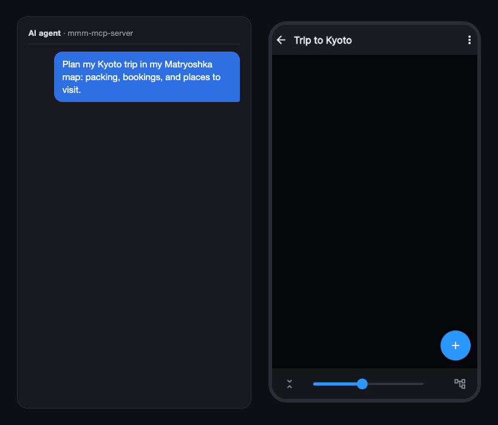

# Matryoshka Mind Map MCP Server

[English](https://github.com/nhorie-canal/mmm_mcp/blob/main/README.md) | 日本語

**AIとのやりとりを、文字から図へ。** 長い会話を読み返す代わりに、Claude などのいつもの AI エージェントが[マトリョシカ マインドマップ](https://matryoshkamap.web.app)に入れ子の TODO や Mermaid の図を書き込みます。あなたはアプリでひと目で見て、直して、チェック。あなたが直した内容は AI も読み返します。



**アプリ本体（基本無料）**: [Web版](https://matryoshkamap.web.app)・[App Store](https://apps.apple.com/app/id1613648306)・[Google Play](https://play.google.com/store/apps/details?id=jp.spheres.mm)

## できること

- 「マップ一覧を見せて」— マップの一覧を教えてくれる
- 会話の中で考えた内容を、そのまま入れ子のマップにする
- 「〇〇のタスク終わったよ」— TODOにチェックが付く
- 長いメモやMarkdownを貼って、マップに取り込む
- 会話でまとめた内容を、マップの中に Markdown の文書として保存し、あとで読み出す・書き直す

## はじめる

Google・Apple・メールアドレスのいずれかを連携したアカウントが必要です（匿名のままのアカウントは使えません。アプリの「メールアドレスを連携」で後から連携できます）。

### Claude（Web・Desktop・スマホ）— インストール不要

1. Claude の「設定 → カスタマイズ」の「コネクタ」で、「＋追加 → カスタムコネクタを追加」を開き、名前に `mmm`、URL に次を貼る
   ```
   https://mmm.spheres.jp/mcp
   ```
2. 認証（今すぐサインイン）と OAuth クライアント（自動的に登録）は「検出済み」のまま、「追加」を押す
3. ブラウザが開くので、アプリと同じアカウントでサインインする。Claude に戻り、「コネクタの接続を完了しますか？」で「接続を続行」を押す
4. 話しかける
   - 「mmm のマップ一覧を見せて」
   - 「〇〇マップに、××というタスクを追加して」
   - 「このメモを〇〇マップに取り込んで」

マップの中身を初めて読むときは、Claude があなたに許可を求めます。スマホの Claude にも同じ接続が出ます。Claude の Free プランはカスタムコネクタを1つまで追加できます。

アプリのマイページの「AI と連携」にも、同じ URL と手順があります。

### Claude Code・ほかの MCP 対応クライアント

URL を指定して登録します。Claude Code:

```bash
claude mcp add --transport http mmm https://mmm.spheres.jp/mcp
```

登録後、Claude Code の中で `/mcp` を開いて mmm を選び、ブラウザでサインインします。ほかのクライアントは、Streamable HTTP の MCP サーバーとして上の URL を登録します（OAuth に対応している必要があります。Claude 以外は動作を確かめていません）。

### 旧ローカル版（npx・.mcpb）をお使いの方

ローカル版は停止しました。AI の設定からローカル版の mmm を削除し、上の手順でリモート版を追加してください。アカウントのデータはそのまま使えます。

## プライバシー

- 当社が運営する MCP サーバー（Google Cloud Run、東京）です。接続は、AI のアプリで追加し、ブラウザでアプリと同じアカウントにサインインして「許可する」を押したときだけ行われます（匿名のアカウントでは接続できません）
- AI が依頼したときだけ、あなたのアカウントとしてマップ（Firebase）を読み書きします。アプリと同じアクセス制御です
- マップの中身はサーバーに保存せず、ログにも出しません。開発者が中身を見ることはありません
- サーバーが保存するのは、接続の許可の記録（トークン類はハッシュ）と、1日の呼び出し回数（3日で削除）の2つだけです
- 書き込んだ日の記録（最後に書き込んだ日付と日数だけ）と端末のタイムゾーンは、本人だけが読めるアカウントの領域に保存します。前者は、開発者が利用者数の集計にだけ使います
- 接続は、AI のアプリの設定から外せます。アカウントを削除すると、許可の記録と呼び出し回数も消えます
- AI に渡った内容は、その提供元（Anthropic, PBC など）の規約に従います
- 詳しくは、[プライバシーについて](https://info.spheres.jp/apps/matryoshka-mind-map/#privacy)をご覧ください

## もっと使う

[使い方のコツと応用](https://github.com/nhorie-canal/mmm_mcp/blob/main/docs/guide.ja.md) — 書き方を安定させる・フォルダ単位でタスクを記録する・最新版にする・よくあるトラブル
