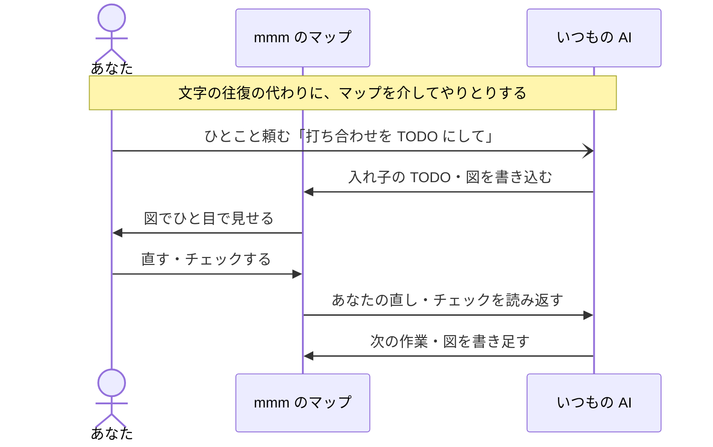

# Matryoshka Mind Map MCP Server

[English](https://github.com/nhorie-canal/mmm_mcp/blob/main/README.md) | 日本語

**AIとのやりとりを、文字から図へ。** Claude などのいつもの AI が、[マトリョシカ マインドマップ](https://matryoshkamap.web.app)に入れ子の TODO や Mermaid の図を書き込みます。あなたはアプリで見て、直して、チェック。その結果を AI も読み返します。


**アプリ本体（基本無料）**: [Web版](https://matryoshkamap.web.app)・[App Store](https://apps.apple.com/app/id1613648306)・[Google Play](https://play.google.com/store/apps/details?id=jp.spheres.mm)

## しくみ



## はじめる

アカウントは Google・Apple・メールのどれかを連携してあることが必要です（匿名のままでは使えません）。

1. AI のコネクタ（MCP）の設定に、次の URL を追加する
   ```
   https://mmm.spheres.jp/mcp
   ```
2. ブラウザが開いたら、アプリと同じアカウントでサインインする
3. チャットで「mmm のマップを見せて」と頼む

Claude Code は次の1行で登録し、`/mcp` から mmm を選んでサインインします。

```bash
claude mcp add --transport http mmm https://mmm.spheres.jp/mcp
```

画面ごとの詳しい手順・無料プランの上限・接続の外し方は[セットアップ](https://github.com/nhorie-canal/mmm_mcp/blob/main/docs/setup.ja.md)にあります。旧ローカル版（npx・.mcpb）は停止しました。AI の設定から削除し、上の手順で追加し直してください。

> [!IMPORTANT]
> ### つないだら、次はこれ → [使い方ガイド](https://github.com/nhorie-canal/mmm_mcp/blob/main/docs/guide.ja.md)
>
> AI に推奨の指示文を貼ると、書き方がそろい、図で見せてくれて、日付は期日として付くようになります。よくあるトラブルもここにあります。

## プライバシー

- AI が依頼したときだけ、あなたのアカウントとしてマップを読み書きします。アプリと同じアクセス制御です
- マップの中身はサーバーに保存せず、ログにも出しません。保存するのは接続の許可（ハッシュ）と1日の呼び出し回数（3日で削除）だけです
- 書き込んだ日（日付と日数だけ）と端末のタイムゾーンを、本人だけが読めるアカウントの領域に保存します。前者は利用者数の集計にだけ使います
- マップの中身を初めて読むときは、AI があなたに許可を求めます
- 接続は AI の設定から外せます。アカウントを削除すると許可の記録も消えます。AI に渡った内容は、その提供元の規約に従います

詳しくは[プライバシーについて](https://info.spheres.jp/apps/matryoshka-mind-map/#privacy)をご覧ください。
