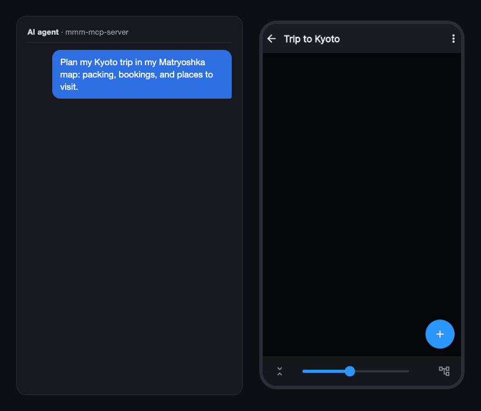
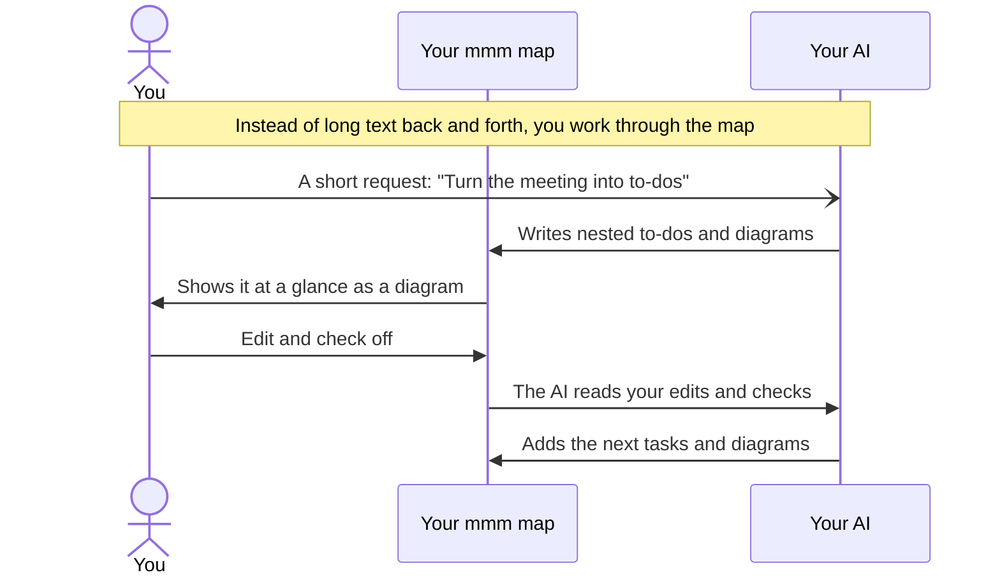

# Matryoshka Mind Map MCP Server

English | [日本語](https://github.com/nhorie-canal/mmm_mcp/blob/main/README.ja.md)

**Work with your AI in maps, not text.** Your usual AI, such as Claude, writes nested to-dos and Mermaid diagrams into [Matryoshka Mind Map](https://matryoshkamap.web.app). You look, edit and check things off in the app, and the AI reads your changes back.



**The app (free to start)**: [Web](https://matryoshkamap.web.app) · [App Store](https://apps.apple.com/app/id1613648306) · [Google Play](https://play.google.com/store/apps/details?id=jp.spheres.mm)

## How it works



## Get started

Your account must be linked to Google, Apple or email (anonymous-only accounts cannot connect).

1. Add this URL to your AI's connector (MCP) settings
   ```
   https://mmm.spheres.jp/mcp
   ```
2. When the browser opens, sign in with the same account as the app
3. Ask in chat: "Show me my mmm maps"

In Claude Code, register it with this line, then open `/mcp`, choose mmm and sign in:

```bash
claude mcp add --transport http mmm https://mmm.spheres.jp/mcp
```

Screen-by-screen steps, free-plan limits and how to disconnect are in the [setup guide](https://github.com/nhorie-canal/mmm_mcp/blob/main/docs/setup.md). The old local version (npx / .mcpb) has been stopped; remove it from your AI's settings and add the URL above instead.

> [!IMPORTANT]
> ### Connected? Next → [User guide](https://github.com/nhorie-canal/mmm_mcp/blob/main/docs/guide.md)
>
> Paste the recommended instructions into your AI to get consistent maps, diagrams first, and real due dates. Troubleshooting is there too.

## Privacy

- It reads and writes your maps as you, only when your AI asks. The same access control as the app applies
- Map contents are not stored on the server or written to logs. The server keeps only connection grants (hashed) and daily call counts (deleted after 3 days)
- The days you wrote (dates and a count only) and your device's time zone are kept in a part of your account only you can read. The former is used only to count users
- The first time a map's contents are read, the AI asks for your permission
- You can disconnect from your AI's settings. Deleting your account removes the grants. Content passed to your AI is subject to its provider's terms

See [Privacy](https://info.spheres.jp/en/apps/matryoshka-mind-map/#privacy) for details.
