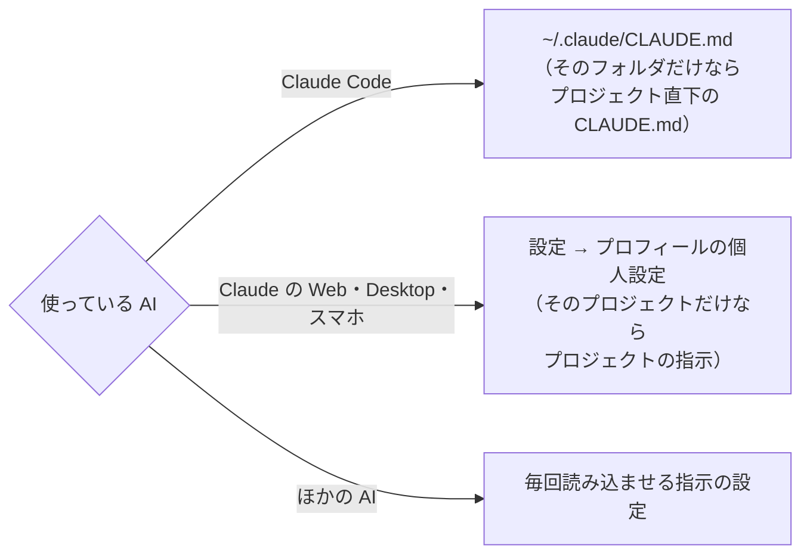
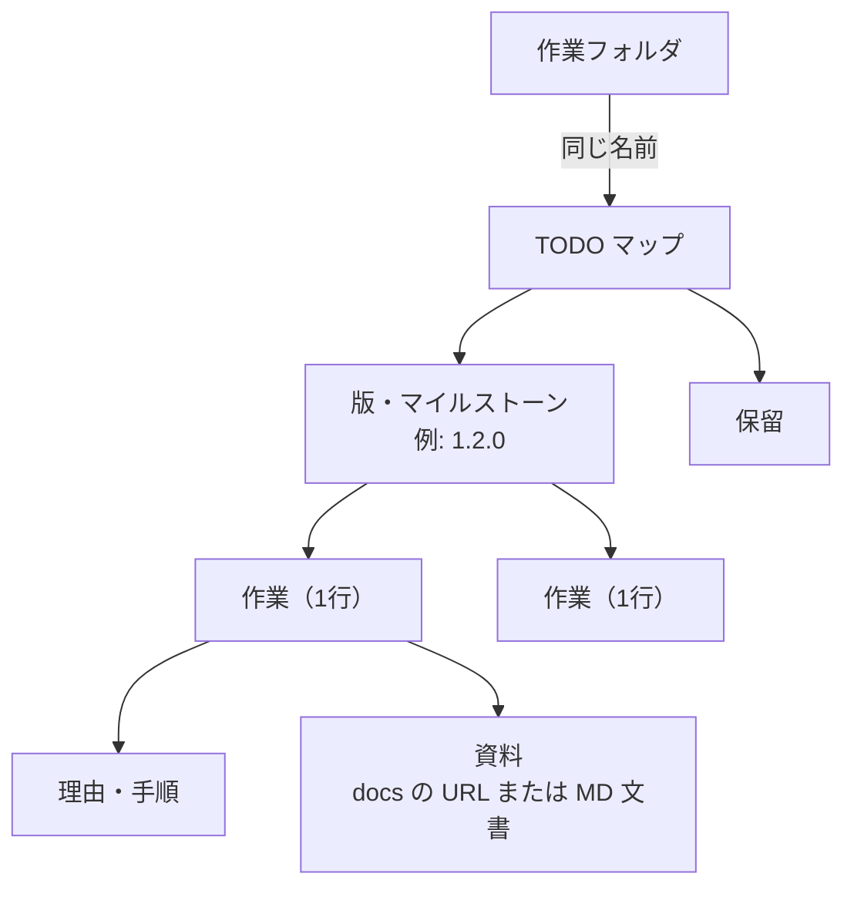

# 使い方ガイド

[README に戻る](https://github.com/nhorie-canal/mmm_mcp/blob/main/README.ja.md) ・ [セットアップ](https://github.com/nhorie-canal/mmm_mcp/blob/main/docs/setup.ja.md)

| 節 | こんなときに |
|---|---|
| [1. 推奨の指示文](#1-推奨の指示文) | まず貼る。マップが読みやすくなり、AI が図で見せてくれる |
| [2. 開発の作業管理に使う](#2-開発の作業管理に使う) | AI との開発で、タスクと資料を mmm にまとめたい |
| [3. よくあるトラブル](#3-よくあるトラブル) | うまく動かない |

## 1. 推奨の指示文

AI が毎回読み込む指示に、次の文言を貼ります。



```markdown
## mmmへの書き方

- 1つの要素は1行で読み切れる長さにする。理由や補足は子要素として1段下に置く
- URLは単独の要素にする。説明文と混ぜず、「資料」などの要素の子に URL だけを置く
- やり忘れを防ぐ項目は、いつやるかの順に並べる。日付が決まるものは本文に書かず、
  `set_schedule` で期日または着手日として付ける。日付の決まらないきっかけ
  （「リリース直後」「〇〇になったら」）だけ、親の要素の名前にしてその下に並べる

## 図で見せる

- 流れ・手順・構成・関係・状態の変化を説明するときは、文章より先に Mermaid の図を出す
- 図の種類は内容で選ぶ（手順・分岐はフローチャート、やりとりはシーケンス図、
  状態は状態遷移図、日程はガント）。数値の比較と一覧だけは表にする
- mmm に計画・設計・手順を書き込むときは、項目に加えて Mermaid の図を入れた
  MD 文書（`create_document`）を添える
```

| 規則 | 理由 |
|---|---|
| 1行にする | 入れ子で表示するので、1つが長いと一覧性が落ちる |
| URL を混ぜない | 説明文と同じ要素にあるとリンクにならず、タップしても開けない |
| いつやるかの順に並べる | 順に消していく形になり、抜けに気づきやすい |
| 日付は期日・着手日にする | アプリで期限切れは赤・今日は橙で目立ち、期日が近づくと通知が届く。本文の日付は文字のまま |
| 図で見せる | 長い文章を読み返さずに分かる。MD 文書の図はアプリで図として表示され、AI があとから読み返して直せる |

MD 文書の表示にはアプリ 5.3.0 以降が要ります。無料プランでは、1つのマップに置ける文書は3個までです。

## 2. 開発の作業管理に使う

作業フォルダごとにマップを1つ持ち、出てきたタスクと資料を AI に記録させる使い方です。「1. 推奨の指示文」に加えて貼ります。



````markdown
## 作業の管理（mmm）

この作業フォルダで出てきたタスクと資料は、Matryoshka Mind Map（mmm）の MCP に記録する。

- **「あとでやること」は mmm にだけ置く。** 計画書のチェックボックス、このファイル、
  会話の中だけ、といった場所に残さない。設計書から生まれた作業も、報告で挙げた
  残作業・未確認の事項も、その場で mmm に項目として起こす
- マップのタイトルは作業フォルダの名前にする。`list_maps` で同じ名前のマップを探し、
  無ければ確認を挟まず `create_map`（TODO マップ）で作ってよい
- 版やマイルストーンごとに親の要素を作り、その下に作業を並べる
- **終わった作業はその場でチェックを入れる。** 「優先度が下がった」「保留」は完了ではないので、
  チェックせず「保留」の親の下へ移す
- 調査・比較・設計メモなどの資料は Markdown で残す。GitHub のリポジトリがあれば `docs/` に置き、
  関係する項目の子にそのファイルの URL を置く。無ければ MD 文書（`create_document`）として作る。
  直すときは `read_document` で読み、返ってきた `updateTime` を `baseUpdateTime` に付けて
  `update_document` で全文を上書きする
- 進み具合を聞かれたら、記憶で答えず `list_elements` で読み直してから答える
- 項目を移す・閉じる・消す前に、今の状態を読み直す。人が入れたチェックを未完了に戻さない
````

| 規則 | 理由 |
|---|---|
| 「あとでやること」を mmm にだけ置く | 置き場所が散ると、次の会話の AI も人も残作業を見落とす |
| マップをフォルダの名前で作る | 確認なしで作ってよいと書くと、AI が自分で作る（書かなければ作る前に確認する） |
| 版ごとの親の下に並べる | 潜っていけば、版ごとの残りがひと目で分かる |
| その場でチェックする | 未チェックの数が、そのまま残作業になる |
| 資料を作業の子から辿れるようにする | 作業と根拠が同じ場所に並び、チャットを閉じても消えない |
| 聞かれたら読み直す | MCP は、アプリでの操作を自動では知らない |

- Claude Code でどのフォルダでも使うには、`--scope user` を付けて登録します（[セットアップ](https://github.com/nhorie-canal/mmm_mcp/blob/main/docs/setup.ja.md)）
- フォルダごとにマップが増えるので、普段のマップと分けたいときは専用のアカウントを使うか、対象のフォルダを絞ってください
- マップの中身を初めて読むときの確認は、この使い方でも省けません（秘匿情報への配慮として、サーバーが求めます）

## 3. よくあるトラブル

| 症状 | 対処 |
|---|---|
| マップの中身を教えてくれない・確認で止まる | 「読んでいいですか」に「はい」と答える |
| 「無料プランの上限」で書き込めない | 別のマップに分けるか、アプリのマイページから有料プランにする（1か月無料）。有料なのに止まるときは、同じアカウントで接続しているか確かめる |
| 「1日の呼び出し回数の上限」と出る | 1人1日1,000回まで。日本時間の朝9時にリセットされる |
| 接続しようとするとサインインで断られる | 匿名のままのアカウントは接続できない。アプリのマイページでメール・Google・Apple を連携する |
| Claude でコネクタを追加できない | Claude の Free プランはカスタムコネクタを1つまで。使っていないものを外す |
| 大きなマップを読み込めない | 要素が数百を超えると、一度に受け取れないことがある。マップを分ける（最上位の要素を長押しして画面上端の見出しに重ねると、配下ごと独立したマップになる） |
