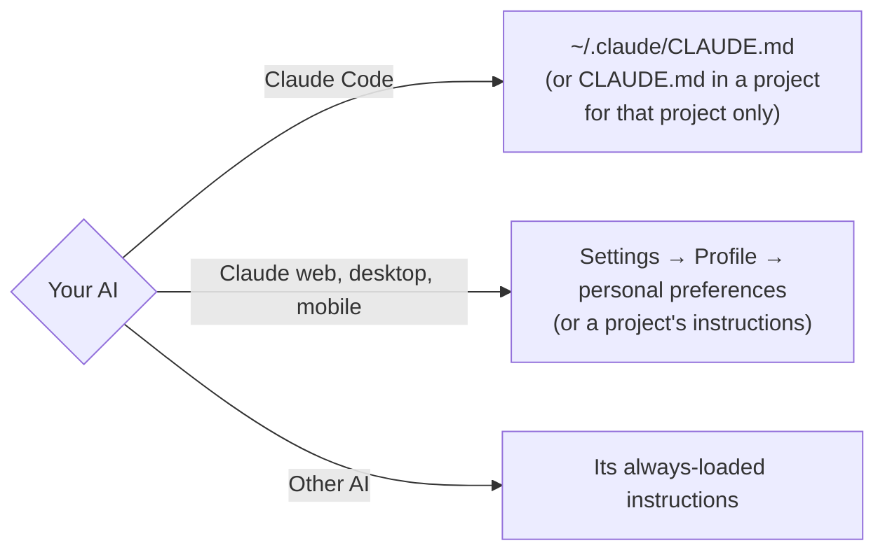
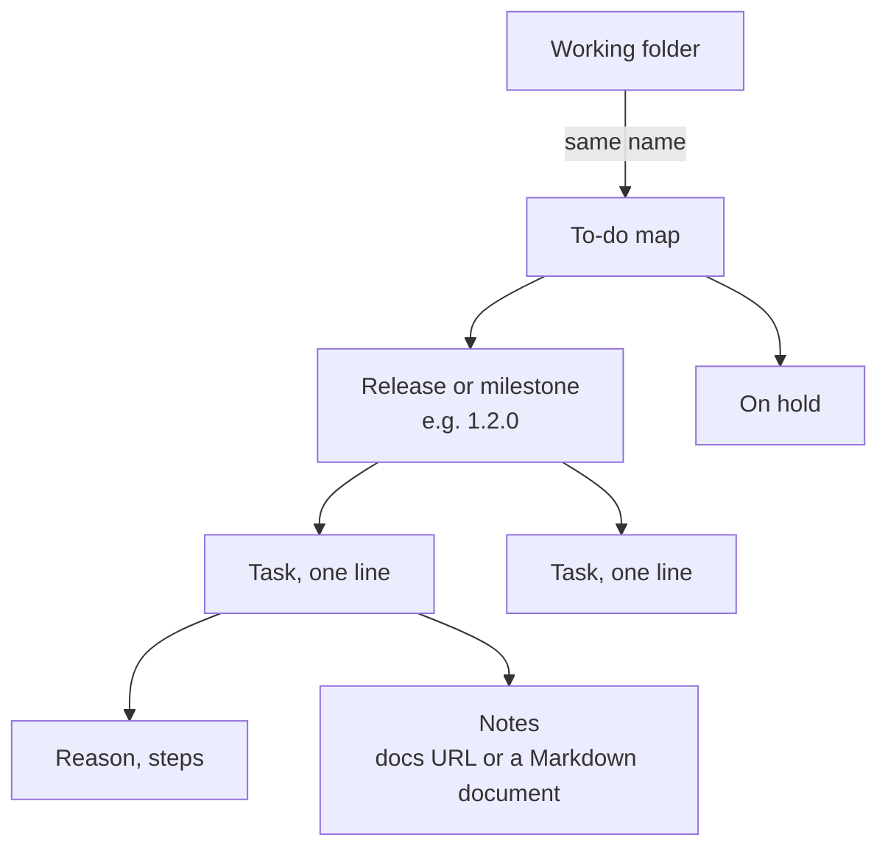

# User guide

[Back to README](https://github.com/nhorie-canal/mmm_mcp/blob/main/README.md) · [Setup](https://github.com/nhorie-canal/mmm_mcp/blob/main/docs/setup.md)

| Section | When |
|---|---|
| [1. Recommended instructions](#1-recommended-instructions) | Paste these first. Your maps stay readable and the AI shows diagrams |
| [2. Managing development work](#2-managing-development-work) | Keep the tasks and notes of AI-assisted development in mmm |
| [3. Troubleshooting](#3-troubleshooting) | Something does not work |

## 1. Recommended instructions

Paste the following into the instructions your AI loads every time.



```markdown
## How to write in mmm

- Keep each element short enough to read in one line. Put reasons and notes one level
  down as child elements.
- Put a URL in its own element. Do not mix it with text; put only the URL under an
  element such as "Docs".
- Order reminder items by when to do them. If an item has a date, do not write it in
  the text; set it as a due date or start date with `set_schedule`. Only triggers
  without a date ("Right after release", "When X happens") become the name of a parent
  element, with the items under it.

## Show it as a diagram

- When explaining a flow, steps, structure, relationships or state changes, show a
  Mermaid diagram before the text.
- Pick the diagram type by content (steps and branches: flowchart; exchanges: sequence
  diagram; states: state diagram; schedules: Gantt). Use a table only for comparing
  numbers and for lists.
- When writing a plan, design or procedure into mmm, add a Markdown document
  (`create_document`) with a Mermaid diagram alongside the elements.
```

| Rule | Why |
|---|---|
| One line per element | Elements are shown nested, so long ones hurt readability |
| Keep URLs separate | A URL mixed with text is not a link in the app |
| Order by when to do them | Checking items off in order makes gaps easy to spot |
| Dates as due/start dates | The app highlights overdue items in red and today's in orange, and notifies you as the due date approaches. A date in the text stays plain text |
| Show it as a diagram | You understand it without rereading long text. Diagrams in documents are drawn in the app, and the AI can read and update them later |

Showing Markdown documents requires app 5.3.0 or later. The free plan allows 3 documents per map.

## 2. Managing development work

Keep one map per working folder and let the AI record the tasks and notes that come up. Paste this in addition to section 1.



````markdown
## Task management (mmm)

Record the tasks and notes that come up in this working folder in the Matryoshka Mind Map (mmm) MCP.

- **Keep "things to do later" only in mmm.** Not in plan checkboxes, this file, or only in
  the conversation. Tasks from design docs and open items you mention in reports go into
  mmm right away.
- Use the working folder's name as the map title. Look for it with `list_maps`; if it does
  not exist, create it with `create_map` (to-do map) without asking.
- Create a parent element per release or milestone and put its tasks under it.
- **Check off finished tasks right away.** "Lower priority" or "on hold" is not done; move
  such tasks under an "On hold" parent without checking them.
- Keep research, comparisons and design notes in Markdown. With a GitHub repository, put
  them in `docs/` and add the file's URL under the related element; otherwise create a
  Markdown document (`create_document`). To edit, read it with `read_document`, pass the
  returned `updateTime` as `baseUpdateTime`, and overwrite it with `update_document`.
- When asked about progress, reread with `list_elements` instead of answering from memory.
- Before moving, closing or deleting items, reread the current state. Never uncheck items a
  person checked.
````

| Rule | Why |
|---|---|
| Keep "later" items only in mmm | Scattered places make the next session's AI and you miss leftovers |
| Create the map from the folder name | Saying "without asking" lets the AI create it itself (otherwise it asks first) |
| Group under releases | Drilling down shows what is left per release at a glance |
| Check off right away | The number of unchecked items is exactly what is left |
| Link notes from tasks | Work and its reasons sit together and survive closing the chat |
| Reread when asked | The MCP does not learn about changes made in the app |

- To use it in every folder in Claude Code, register it with `--scope user` ([setup](https://github.com/nhorie-canal/mmm_mcp/blob/main/docs/setup.md)).
- A map is created per folder. To keep them apart from your usual maps, use a separate account or limit the folders.
- The permission check the first time a map is read cannot be skipped, even with this setup (the server requires it to protect private content).

## 3. Troubleshooting

| Symptom | What to do |
|---|---|
| The AI will not show map contents / stops at the confirmation | Answer "yes" when asked for permission to read |
| "Free plan limit" blocks a write | Split into another map, or upgrade from My Page in the app (first month free). If it still blocks you, check that you connected with the same account |
| "Daily call limit" | 1,000 calls per person per day; resets at 00:00 UTC |
| Sign-in is refused when connecting | Anonymous-only accounts cannot connect. Link email, Google or Apple from My Page in the app |
| Cannot add the connector in Claude | Claude's Free plan allows one custom connector. Remove one you do not use |
| The AI cannot load a large map | With several hundred elements, the response may not fit at once. Split the map (long-press a top-level element and drop it on the header at the top of the screen to make it a separate map) |
