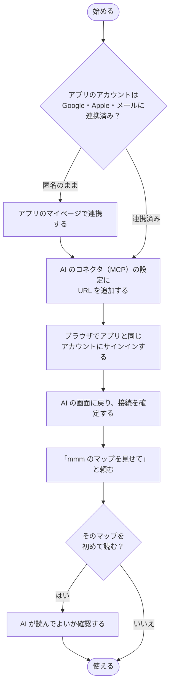

# セットアップ

[README に戻る](https://github.com/nhorie-canal/mmm_mcp/blob/main/README.ja.md) ・ **[使い方ガイド](https://github.com/nhorie-canal/mmm_mcp/blob/main/docs/guide.ja.md)**

URL を AI に登録して、ブラウザでサインインするだけです。何もインストールしません。



## Claude（Web・Desktop・スマホ）

1. 「設定 → カスタマイズ」の「コネクタ」で、「＋追加」→「カスタムコネクタを追加」を開く
2. 名前に `mmm`、URL に次を貼る
   ```
   https://mmm.spheres.jp/mcp
   ```
3. 認証（今すぐサインイン）と OAuth クライアント（自動的に登録）は「検出済み」のまま「追加」を押す
4. 開いたブラウザで、アプリと同じアカウントでサインインする
5. Claude に戻り、「コネクタの接続を完了しますか？」で「接続を続行」を押す

スマホの Claude にも同じ接続が出ます。Claude の Free プランは、カスタムコネクタを1つまで追加できます。アプリのマイページの「AI と連携」にも、同じ URL（コピーのボタン付き）があります。

## Claude Code

```bash
claude mcp add --transport http mmm https://mmm.spheres.jp/mcp
```

Claude Code の中で `/mcp` を開き、mmm を選んでブラウザでサインインします。どのフォルダでも使うときは `--scope user` を付けて登録します。

## ほかの AI

Streamable HTTP の MCP サーバーとして上の URL を登録します（OAuth に対応している必要があります。Claude 以外は動作を確かめていません）。

## 上限

| 項目 | 無料プラン | 有料プラン |
|---|---|---|
| マップ | 20個 | 上限なし |
| 1つのマップの要素 | 300個 | 上限なし |
| 1つのマップの文書 | 3個 | 上限なし |
| ツールの呼び出し | 1人1日1,000回（日本時間の朝9時にリセット） | 同じ |

上限に達すると、AI は何も書かずに理由を伝えます。有料プランはアプリのマイページから申し込みます（1か月無料）。有料プランにしたのと同じアカウントで接続してください。

## 接続を外す

AI の設定のコネクタから mmm を削除します。アプリでアカウントを削除すると、すべての接続の許可が消えます。

## 旧ローカル版（npx・.mcpb）

停止しました。AI の設定からローカル版の mmm を削除し（Claude Code は `claude mcp remove mmm`）、上の手順で追加し直してください。アカウントのデータはそのまま使えます。
