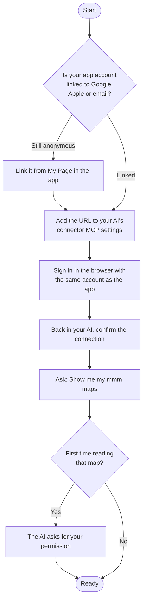

# Setup

[Back to README](https://github.com/nhorie-canal/mmm_mcp/blob/main/README.md) · **[User guide](https://github.com/nhorie-canal/mmm_mcp/blob/main/docs/guide.md)**

Register a URL with your AI and sign in in the browser. Nothing to install.



## Claude (web, desktop, mobile)

1. In **Settings → Customize → Connectors**, open **+ Add → Add custom connector**
2. Enter `mmm` as the name and paste this URL
   ```
   https://mmm.spheres.jp/mcp
   ```
3. Leave Authentication ("Sign in now") and OAuth client ("Register automatically") as detected, and press **Add**
4. In the browser that opens, sign in with the same account as the app
5. Back in Claude, confirm to finish connecting

The connection also appears in the Claude mobile app. Claude's Free plan allows one custom connector. The same URL (with a copy button) is in the app under My Page → "Connect to AI".

## Claude Code

```bash
claude mcp add --transport http mmm https://mmm.spheres.jp/mcp
```

Inside Claude Code, open `/mcp`, choose mmm and sign in in the browser. To use it in every folder, add `--scope user`.

## Other AI clients

Register the URL above as a Streamable HTTP MCP server (it needs OAuth support; clients other than Claude have not been tested).

## Limits

| Item | Free plan | Paid plan |
|---|---|---|
| Maps | 20 | Unlimited |
| Elements per map | 300 | Unlimited |
| Documents per map | 3 | Unlimited |
| Tool calls | 1,000 per person per day (resets at 00:00 UTC) | Same |

When a limit is reached, the AI writes nothing and tells you why. Upgrade from My Page in the app (first month free), and connect with the same account you upgraded.

## Disconnecting

Remove mmm from your AI's connector settings. Deleting your account in the app removes every connection grant.

## Old local version (npx / .mcpb)

It has been stopped. Remove the local mmm from your AI's settings (in Claude Code, `claude mcp remove mmm`) and add it again with the steps above. Your account data stays the same.
